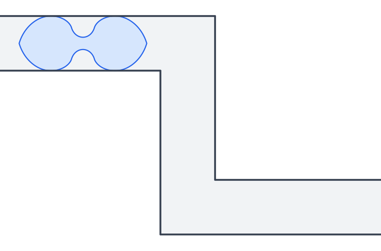
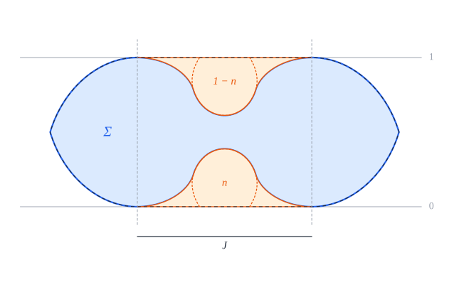
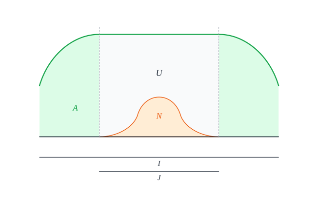

# Optimality and uniqueness of Romik's ambidextrous sofa, in Lean 4

[](https://github.com/vltanh/lean4-ambidextrous-sofa/actions/workflows/lean_action_ci.yml?query=branch%3Amain)

The ambidextrous moving sofa problem asks for the largest area of a shape that can be moved around the
right-angled corner of a hallway of unit width that turns right, and also, from the same starting position,
around one that turns left. In 2016 Dan Romik constructed a shape of area

  `M = 1 + 4Y² + arctan Y = ∛(3 + 2√2) + ∛(3 − 2√2) − 1 + arctan(½(∛(√2 + 1) − ∛(√2 − 1))) = 1.64495…`,

where `Y = 0.2980…` is the positive root of `4Y³ + 3Y = 1`, and proposed it as a likely solution. This
repository proves in Lean 4, with Mathlib, that Romik's sofa is optimal and that, up to rotations and
translations, it is the only optimal shape.

The proof uses one result from the literature, Jineon Baek's theorem that Gerver's sofa is optimal for the
ordinary problem; its Lean formalization comes from
[lean4-moving-sofa](https://github.com/vltanh/lean4-moving-sofa) and is included here. No person has checked the
proofs; Lean's kernel checks all of them.



Each motion of Romik's sofa turns it by exactly a quarter turn, so it can also travel along one hallway that
turns right and then left.

## Definitions

All the definitions are in [`Challenge.lean`](Challenge.lean), which imports only Mathlib, and
[docs/definitions.md](docs/definitions.md) explains each one. The plane is `ℝ × ℝ` and the area of a set is its
Lebesgue measure. The two hallways share the incoming arm `(−∞, 1] × [0, 1]`; the one that turns right continues
with `[0, 1] × (−∞, 1]`, the one that turns left with `[0, 1] × [0, ∞)`. An ambidextrous sofa is a compact
connected set that moves through both, by two continuous rigid motions that start with the same orientation:

```lean
def MovesThrough (S hallway incoming outgoing : Set (ℝ × ℝ)) (θ : ℝ → ℝ) (c : ℝ → ℝ × ℝ) :
    Prop :=
  ContinuousOn θ (Icc 0 1) ∧ ContinuousOn c (Icc 0 1) ∧
    (∀ p ∈ S, rotate (θ 0) p + c 0 ∈ incoming) ∧
    (∀ t ∈ Icc (0 : ℝ) 1, ∀ p ∈ S, rotate (θ t) p + c t ∈ hallway) ∧
    (∀ p ∈ S, rotate (θ 1) p + c 1 ∈ outgoing)

def IsAmbidextrous (S : Set (ℝ × ℝ)) : Prop :=
  IsCompact S ∧ IsConnected S ∧
    ∃ (θ₁ θ₂ : ℝ → ℝ) (c₁ c₂ : ℝ → ℝ × ℝ), rotate (θ₁ 0) = rotate (θ₂ 0) ∧
      MovesThrough S (incomingArm ∪ lowerOutgoingArm) incomingArm lowerOutgoingArm θ₁ c₁ ∧
      MovesThrough S (incomingArm ∪ upperOutgoingArm) incomingArm upperOutgoingArm θ₂ c₂
```

The motions may pause, turn back and turn through any angle. They must start with the same orientation:
otherwise Gerver's sofa, which is symmetric in a vertical line, would pass the left-turning hallway after a half
turn, and the problem would be the ordinary one.



Romik's sofa `referenceSofa Y` is its convex hull `referenceHull Y`, whose support function is given by an
explicit formula, with two open regions removed: the *niche* swept by the inner corner of the right-turning
hallway as the hallway turns about the hull, and its mirror image for the left-turning hallway.

## Results

[`Challenge.lean`](Challenge.lean) states nine theorems, and [`Solution.lean`](Solution.lean) proves them;
Comparator checks that the second proves exactly the first ([`comparator.json`](comparator.json)). The main
ones:

```lean
theorem Ambidextrous.volume_le (Y : ℝ) (hY : 0 < Y ∧ 4 * Y ^ 3 + 3 * Y = 1) (S : Set (ℝ × ℝ))
    (hS : IsAmbidextrous S) : volume.real S ≤ 1 + 4 * Y ^ 2 + Real.arctan Y

theorem Ambidextrous.volume_eq_iff (Y : ℝ) (hY : 0 < Y ∧ 4 * Y ^ 3 + 3 * Y = 1) (S : Set (ℝ × ℝ))
    (hS : IsAmbidextrous S) :
    volume.real S = 1 + 4 * Y ^ 2 + Real.arctan Y ↔
      ∃ (θ : ℝ) (v : ℝ × ℝ), S = (fun p => rotate θ p + v) '' referenceSofa Y
```

| Theorem | In words |
| --- | --- |
| `volume_le` | every ambidextrous sofa has area at most `M` |
| `volume_eq_iff` | an ambidextrous sofa has area `M` if and only if it is a rotated and translated copy of Romik's sofa |
| `quarter_turns` | in an ambidextrous sofa of area `M`, each of the two motions turns the body through a full quarter turn at some moment |
| `isAmbidextrous_referenceSofa` | Romik's sofa is an ambidextrous sofa |
| `isAmbidextrous_image_referenceSofa` | so is every rotated and translated copy of it |
| `volume_referenceSofa` | Romik's sofa has area `M` |
| `convexHull_referenceSofa` | the convex hull of Romik's sofa is `referenceHull Y` |
| `existsUnique_root` | `4Y³ + 3Y = 1` has exactly one positive solution |
| `value_eq_romik` | `M` is Romik's closed form above |

Romik's sofa is symmetric in the line `y = 1/2`, so uniqueness up to rotations and translations is uniqueness up
to congruence.

## Proof outline

Unless its area is at most `√2 < M`, each motion turns the body through more than `π/4`, and the proof keeps,
for each motion, an angle in `(π/4, π/2]` through which the body has turned. After a rigid normalization the
body lies in the strip `0 ≤ y ≤ 1`, and its convex hull splits into an upper *cap* `U` and the reflection `V` of
its lower cap. The area of the body is at most `P_α(U) + P_γ(V)`, where the *score* `P_α` of a cap is the area
under its roof over the two outer quarters of its projection, minus the part of the middle half that the
hallway's inner corner sweeps while the hallway turns by `α`.



The main step bounds the score of a cap: `P_α(U) ≤ M/2`, with equality only for `α = π/2` and `U` a translate of
Romik's cap. For the full turn, a cap of maximal score exists by compactness, and polygonal approximations give
it curvature densities and endpoint laws; a tilted middle roof is then excluded, and a horizontal one is
calibrated by a functional whose maximum `M/2` is attained only at Romik's cap. For a partial turn the score
keeps the whole outgoing wall of the hallway, which makes it strictly smaller. Two of the exclusions use the
bound `22199/10000` that Baek's theorem gives for the ordinary problem.

If the body has area `M`, both caps have score `M/2`, so both motions make a full quarter turn and both caps are
Romik's; an exact deficit identity then recovers the body. [docs/layout.md](docs/layout.md) lists the modules.

## Prior work

Leo Moser posed the moving sofa problem in 1966, and the ambidextrous variant goes back to John Conway, G. C.
Shephard and others. Romik derived his ambidextrous sofa from differential equations (*Experimental
Mathematics*, 2018). Baek proved in 2024 that Gerver's sofa is optimal for the ordinary problem
(arXiv:2411.19826), and Georgiev, Gómez-Serrano, Tao and Wagner listed the ambidextrous problem as open in 2025
(arXiv:2511.02864, Problem 6.63). [docs/prior-work.md](docs/prior-work.md) gives the references, including
computer-assisted bounds and other formalizations.

## Verification

```sh
lake exe cache get
lake build
lake env lean scripts/Audit.lean
python3 scripts/sync_challenge_defs.py --check
lake env lake comparator --config=comparator.json
```

Lean and Mathlib are pinned at `v4.35.0-rc3`. The only `sorry`s are the nine statements of the Challenge; the
audit checks that every declaration uses only the axioms `propext`, `Classical.choice` and `Quot.sound`; and
Comparator checks, with Lean's kernel and with NanoDa, that the Solution proves exactly the Challenge.
[docs/verification.md](docs/verification.md) explains each check.

## Layout

```text
Challenge.lean, Solution.lean   the statements of record and their proofs
comparator.json                 Comparator's configuration
formalization.yaml              the metadata for the Palomar registry
AmbidextrousSofa/               the proof
  Main.lean                     the main theorems in the Challenge's vocabulary
  Theorems/Optimality.lean      the main theorems in the library's vocabulary
  Reference/                    Romik's ambidextrous sofa
  Analysis/                     the bound on the score of a cap and its equality cases
MovingSofaOptimality/           Baek's theorem, copied from lean4-moving-sofa
docs/                           definitions, layout, verification, prior work, credits, figures, archive
scripts/                        the axiom audit, the copy of the definitions, the figures
```

## Credits

The-Anh Vu-Le directed the work. ChatGPT Pro 6 (OpenAI) found the proof, in research notes that ended with a
manuscript ([archive](docs/archive/README.md)), and wrote a first Lean draft. Claude Opus 5.5 (Anthropic), in
Claude Code, made the draft compile, simplified it, and wrote the Challenge, the Solution and the
documentation. [docs/CREDITS.md](docs/CREDITS.md) records how.

## License

Apache-2.0 ([`LICENSE`](LICENSE)), as for Mathlib and lean4-moving-sofa.
