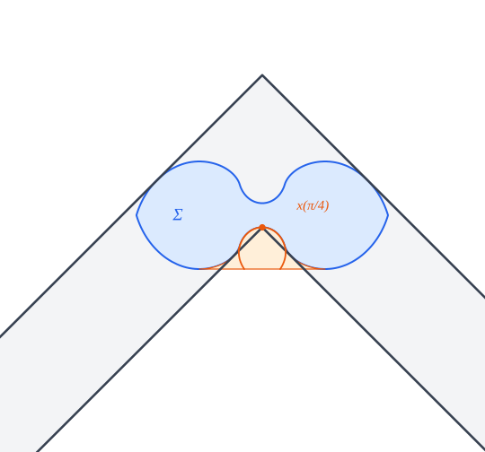

# Optimality and uniqueness of Romik's ambidextrous sofa, in Lean 4

[](https://github.com/vltanh/lean4-ambidextrous-sofa/actions/workflows/lean_action_ci.yml?query=branch%3Amain)

The ambidextrous moving sofa problem asks for the largest area of a shape that can be moved around the
right-angled corner of a hallway of unit width that turns right, and also, from the same starting position,
around one that turns left. Dan Romik constructed in 2016 a shape of area

  `M = 1 + 4Y² + arctan Y = ∛(3 + 2√2) + ∛(3 − 2√2) − 1 + arctan(½(∛(√2 + 1) − ∛(√2 − 1))) = 1.64495…`,

where `Y = 0.2980…` is the positive root of `4Y³ + 3Y = 1`, and proposed it as a likely solution. This
repository proves in Lean 4, with Mathlib, that Romik's sofa is optimal: every ambidextrous sofa has area at
most `M`. It is also the only optimal shape, since an ambidextrous sofa of area `M` is a rotated and translated
copy of Romik's sofa.

ChatGPT Pro 6 found the proof and wrote an uncompiled Lean draft of it, and Claude Opus 5.5 made the draft
compile. The research notes behind the proof ended with a manuscript, which is [archived](docs/archive/README.md)
here. No person has checked the proofs; Lean's kernel checks all of them. The proof uses one result from the literature, Jineon Baek's
theorem that Gerver's sofa is optimal for the ordinary problem. Its Lean formalization comes from
[lean4-moving-sofa](https://github.com/vltanh/lean4-moving-sofa) and is included here.


Each motion of Romik's sofa turns it by exactly a quarter turn, so it can also travel along one hallway that
turns right and then left: it meets the second corner in the same orientation, relative to the corridor, as
it met the first.

## Definitions

Lean checks the proofs, but only a reader can check that the statements say what they should, so the
definitions are worth reading first. All of them are in [`Challenge.lean`](Challenge.lean), which imports only
Mathlib, and [docs/definitions.md](docs/definitions.md) explains each one.

The plane is `ℝ × ℝ`, and the area of a set is its Lebesgue measure. The two hallways share the incoming arm
`(−∞, 1] × [0, 1]`; the one that turns right continues with `[0, 1] × (−∞, 1]`, the one that turns left with
`[0, 1] × [0, ∞)`. An ambidextrous sofa is a compact connected set that moves through both, by two continuous
rigid motions that start with the same orientation:

```lean
def MovesThrough (S hallway incoming outgoing : Set (ℝ × ℝ)) (θ : ℝ → ℝ) (c : ℝ → ℝ × ℝ) :
    Prop :=
  ContinuousOn θ (Icc 0 1) ∧ ContinuousOn c (Icc 0 1) ∧
    (∀ p ∈ S, rotate (θ 0) p + c 0 ∈ incoming) ∧
    (∀ t ∈ Icc (0 : ℝ) 1, ∀ p ∈ S, rotate (θ t) p + c t ∈ hallway) ∧
    (∀ p ∈ S, rotate (θ 1) p + c 1 ∈ outgoing)

def IsAmbidextrous (S : Set (ℝ × ℝ)) : Prop :=
  IsCompact S ∧ IsConnected S ∧
    ∃ (θ₁ θ₂ : ℝ → ℝ) (c₁ c₂ : ℝ → ℝ × ℝ), rotate (θ₁ 0) = rotate (θ₂ 0) ∧
      MovesThrough S (incomingArm ∪ lowerOutgoingArm) incomingArm lowerOutgoingArm θ₁ c₁ ∧
      MovesThrough S (incomingArm ∪ upperOutgoingArm) incomingArm upperOutgoingArm θ₂ c₂
```

The motions may pause, turn back and turn through any angle, and their starting translations may differ.
They must start with the same orientation, though. Without that condition, Gerver's sofa, which is symmetric
under a reflection in a vertical line, would pass the left-turning hallway after a half turn, and the problem
would be the ordinary one.


Romik's ambidextrous sofa `referenceSofa Y` starts from its convex hull `referenceHull Y`, whose support
function has an explicit formula in three trigonometric phases on each quarter of the circle. Two open regions
are removed from the hull. One is the *niche* `n`, swept by the inner corner of the right-turning hallway as
the hallway turns about the hull with its outer walls touching it; the other is its mirror image, swept by the
inner corner of the left-turning hallway. The theorems take `Y` with its defining property
`0 < Y ∧ 4 * Y ^ 3 + 3 * Y = 1`.

## Results

[`Challenge.lean`](Challenge.lean) states eight theorems in Mathlib's vocabulary, and
[`Solution.lean`](Solution.lean) proves them; Comparator checks that the second proves exactly the first
([`comparator.json`](comparator.json)).

```lean
theorem Ambidextrous.volume_le (Y : ℝ) (hY : 0 < Y ∧ 4 * Y ^ 3 + 3 * Y = 1) (S : Set (ℝ × ℝ))
    (hS : IsAmbidextrous S) : volume.real S ≤ 1 + 4 * Y ^ 2 + Real.arctan Y

theorem Ambidextrous.volume_eq_iff (Y : ℝ) (hY : 0 < Y ∧ 4 * Y ^ 3 + 3 * Y = 1) (S : Set (ℝ × ℝ))
    (hS : IsAmbidextrous S) :
    volume.real S = 1 + 4 * Y ^ 2 + Real.arctan Y ↔
      ∃ (θ : ℝ) (v : ℝ × ℝ), S = (fun p => rotate θ p + v) '' referenceSofa Y

theorem Ambidextrous.isAmbidextrous_referenceSofa (Y : ℝ) (hY : 0 < Y ∧ 4 * Y ^ 3 + 3 * Y = 1) :
    IsAmbidextrous (referenceSofa Y)

theorem Ambidextrous.volume_referenceSofa (Y : ℝ) (hY : 0 < Y ∧ 4 * Y ^ 3 + 3 * Y = 1) :
    volume.real (referenceSofa Y) = 1 + 4 * Y ^ 2 + Real.arctan Y
```

| Theorem | In words |
| --- | --- |
| `volume_le` | every ambidextrous sofa has area at most `M` |
| `volume_eq_iff` | an ambidextrous sofa has area `M` if and only if it is the image of Romik's sofa by a rotation and a translation |
| `isAmbidextrous_referenceSofa` | Romik's sofa is an ambidextrous sofa |
| `volume_referenceSofa` | Romik's sofa has area `M` |
| `isAmbidextrous_image_referenceSofa` | so is every image of Romik's sofa by a rotation and a translation |
| `convexHull_referenceSofa` | the convex hull of Romik's sofa is `referenceHull Y` |
| `existsUnique_root` | the equation `4Y³ + 3Y = 1` has exactly one positive solution |
| `value_eq_romik` | `M` is Romik's closed form above |

Romik's sofa is symmetric in the line `y = 1/2`, so its reflected copies are also rotated and translated
copies: uniqueness up to rotations and translations is uniqueness up to congruence. The library states
the same theorems in its own vocabulary in
[`Theorems/Optimality.lean`](AmbidextrousSofa/Theorems/Optimality.lean), together with
`isGreatest_ambidextrous_areas`: `M` is the greatest area of an ambidextrous sofa.

## Proof outline

[docs/layout.md](docs/layout.md) lists the modules of each part.

The proof first reduces a sofa to two caps. Unless its area is at most `√2 < M`, each motion must turn the body
through more than `π/4`, and the proof keeps, for each motion, an angle in `(π/4, π/2]` through which the body
has turned. After a rigid normalization the body lies in the strip `0 ≤ y ≤ 1`, and its convex hull splits
into an upper *cap* `U` and the reflection `V` of its lower cap. The area of the body is at most
`P_α(U) + P_γ(V)`. Here the *score* `P_α` of a cap is the area under its roof over the two outer quarters of
its projection, minus the region of the middle half `J` that the hallway's inner corner sweeps while the
hallway turns by `α`.


The main step bounds the score of a cap: `P_α(U) ≤ M/2`, with equality only for `α = π/2` and `U` a translate
of Romik's cap. For the full turn, a cap of maximal score exists by compactness, and finite polygonal
approximations give it curvature densities and endpoint laws. A tilted middle roof is then excluded, and a
horizontal one is calibrated by an `H¹` functional whose maximum `M/2` is attained only at Romik's cap. For a
partial turn the score keeps the whole outgoing wall of the hallway, and the geometry of the terminal facet,
with reflected curvature bounds, makes it strictly smaller. Two of the strict exclusions use the bound
`22199/10000` that Baek's theorem gives for the ordinary problem.



If the body has area `M`, both caps have score `M/2`, so both motions turn by a full quarter and both caps are
Romik's. An exact deficit identity then recovers the hull, and since Romik's sofa is regular closed, the body
is Romik's sofa itself. The remaining modules work out Romik's sofa: its support function, hull, niche,
motions and area.

## How it was checked

The Lean proofs are ChatGPT Pro 6's draft, repaired. About 850 of its 4,326 theorem proofs did not compile,
mostly because Mathlib lemmas had been renamed since the draft was written, and they were restored by changes
of tactics and names, without changing any argument. The statements needed changes of form only: 77 theorems
in sections with `variable` hypotheses had lost hypotheses that their proofs and callers use, which `include`
puts back, and a few names pointed to the wrong declaration.

An agent separate from the one that wrote the statements of record reviewed them, definition by definition,
against the informal problem and Romik's paper, and found no error. It also checked that the definitions of
Romik's sofa reproduce his Table 2.

## Prior work

More, with references: [docs/prior-work.md](docs/prior-work.md).

Leo Moser posed the moving sofa problem in 1966; John Conway, G. C. Shephard and others considered the
ambidextrous variant soon after, and Maruyama (1973) and Gibbs (2014) computed approximate solutions. Romik
derived his ambidextrous sofa from differential equations (*Experimental Mathematics*, 2018) and asked to prove
that it is locally optimal; Kallus and Romik (2018) noted that the upper bound 2.37 for the ordinary problem
bounds the ambidextrous one too. Baek proved in 2024 that Gerver's sofa is optimal for the ordinary problem
(arXiv:2411.19826). In December 2025, Georgiev, Gómez-Serrano, Tao and Wagner listed the ambidextrous problem as
open (arXiv:2511.02864, Problem 6.63).

## What's next

The Lean proofs still need a cleanup: the build has about 700 linter and deprecation warnings, and a few
lemmas that the draft used without importing their modules are copied privately. The proof should also be
written up as a paper. Some directions from here are the stability of Romik's sofa, as for
[Gerver's](https://github.com/vltanh/lean4-moving-sofa/blob/main/docs/stability.md); the sharper equality
case, in which each motion of an optimal sofa turns it by exactly a quarter turn (the proof shows this, but the
Challenge does not state it); and the variant that Romik mentions alongside, the largest shape that can turn
around in a T-junction.

## Layout

More on each module: [docs/layout.md](docs/layout.md).

```text
Challenge.lean, Solution.lean   the statements of record and their proofs
comparator.json                 Comparator's configuration
formalization.yaml              the metadata for the Palomar registry
AmbidextrousSofa/               the proof (466 modules)
  ChallengeDefs.lean            the definitions that Challenge.lean copies
  Main.lean                     the main theorems in the Challenge's vocabulary
  Theorems/Optimality.lean      the main theorems in the library's vocabulary
  ExactConstant.lean            the root Y and the value M = 1 + 4Y² + arctan Y
  Geometry/, Measure/, Topology/, Algebra/   the plane, motions, caps, hulls and areas
  Reference/                    Romik's ambidextrous sofa: support function, hull, body, motions, area
  Analysis/                     the bound on a cap and its equality cases
MovingSofaOptimality/           Baek's theorem, copied from lean4-moving-sofa (51 modules)
docs/                           these pages, the credits, the figures and the archive
scripts/                        the axiom audit, the Challenge's copy of the definitions, the figures
```

## Verification

More on each check: [docs/verification.md](docs/verification.md).

```sh
lake exe cache get
lake build
lake env lean scripts/Audit.lean
python3 scripts/sync_challenge_defs.py --check
lake env lake comparator --config=comparator.json
```

Lean and Mathlib are pinned at `v4.35.0-rc4`. The build's only `sorry`s are the eight statements of the
Challenge. The audit checks that the 7,474 declarations of the library and the 4,235 of the copied
`MovingSofaOptimality` use only the axioms `propext`, `Classical.choice` and `Quot.sound`, and lists the results
from the literature that the main results use (Baek's theorem, through `MovingSofaOptimality.gm_area_le`).
Comparator accepts the Solution, with Lean's kernel and with NanoDa. GitHub Actions runs all of these except
Comparator on every push.

## License

Apache-2.0 ([`LICENSE`](LICENSE)), as for Mathlib and lean4-moving-sofa.

## Credits

- The-Anh Vu-Le directed the work.
- ChatGPT Pro 6 (OpenAI) found the proof, in research notes started in lean4-moving-sofa, and wrote an
  uncompiled Lean draft of it, about 92,000 lines in 463 modules.
- Claude Opus 5.5 (Anthropic), in Claude Code, following the
  [formalize-math-paper](https://github.com/vltanh/formalize-math-paper) skill, made the draft compile with 42
  sub-agents in under two hours, wrote the Challenge and the Solution, had the statements reviewed,
  wrote these pages and the figures, and moved the project to a newer Mathlib. More:
  [docs/CREDITS.md](docs/CREDITS.md).
